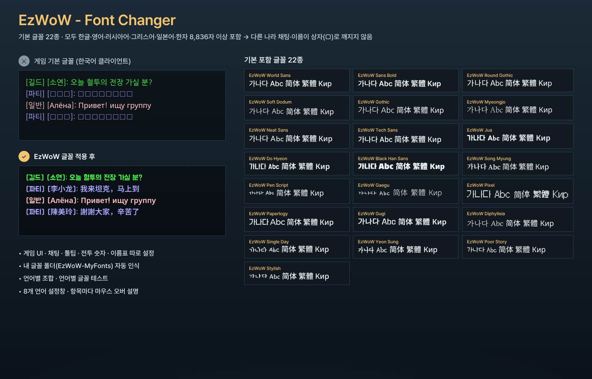
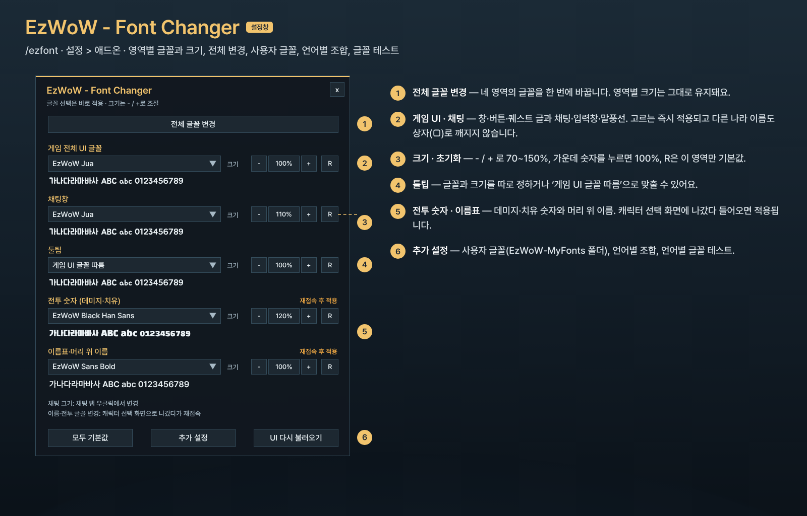
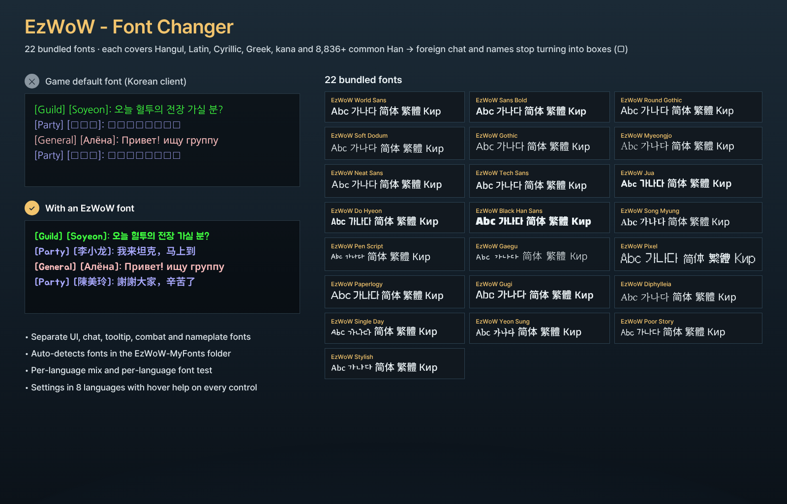
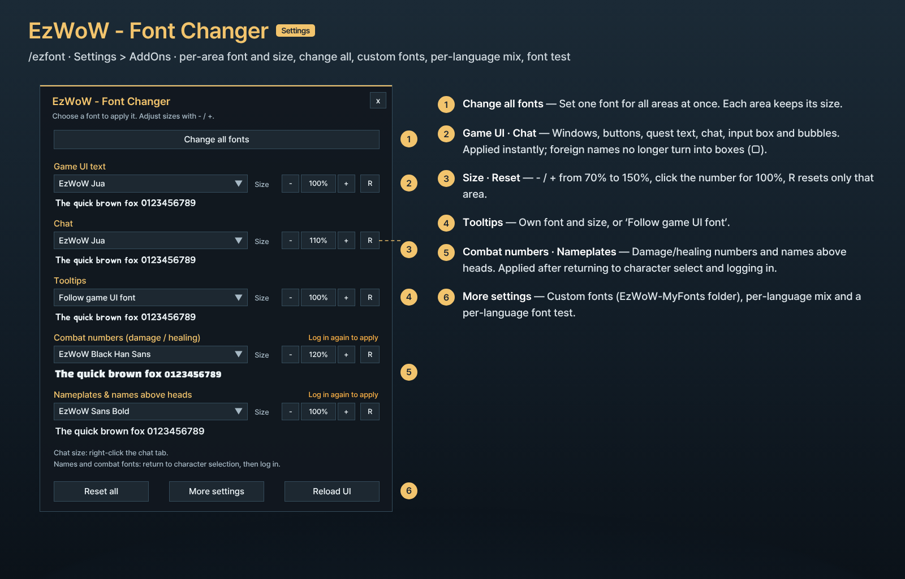

# EzWoW - Font Changer (`EzWoW-FontChanger`)

**[한국어](#한국어) · [English](#english)**

WoW Forever (`Interface: 16001`) · `v1.0.0` · `/ezfont`

---

## 한국어

게임 화면을 다섯 영역으로 나눠 각각 글꼴과 크기를 바꾸는 애드온입니다.

| 영역 | 바뀌는 곳 | 적용 시점 |
|---|---|---|
| 게임 전체 UI 글꼴 | 창·버튼·툴팁·퀘스트 글 등 | 바로 |
| 채팅창 | 채팅 글자, 입력창, 말풍선 | 바로 (크기는 채팅 탭 우클릭 → 글꼴 크기) |
| 툴팁 | 마우스를 올리면 뜨는 설명 창 | 바로 (게임 UI 글꼴을 따르게 할 수도 있음) |
| 전투 숫자 | 머리 위로 뜨는 데미지·치유 숫자 | 재접속 후 |
| 이름표·머리 위 이름 | 이름표, 캐릭터·몬스터 머리 위 이름 | 이름표는 바로, 머리 위 이름은 재접속 후 |

### 화면 미리보기

> 이미지는 애드온 코드의 창 크기·좌표·색상·문구와 실제 포함 글꼴로 재현한 **예시 화면**입니다.

### 포함된 글꼴

모든 글꼴은 예쁜 기본 글꼴의 글자를 그대로 쓰고, 그 글꼴에 없는 글자(악센트 문자, 그리스·키릴 문자, 일본어 가나, 기호)를 Noto 글꼴로 채워 넣었습니다. 한자는 중국·대만에서 일상적으로 쓰는 8,836자(GB2312 + Big5 1단계)를 모든 글꼴에 넣어서, **어느 글꼴을 골라도 플레이어 이름과 채팅이 깨지지 않습니다.** EzWoW World Sans에는 드물게 쓰는 한자까지 2만 9천여 자가 모두 들어 있습니다.

| 글꼴 | 바탕 글꼴 | 느낌 |
|---|---|---|
| EzWoW World Sans | Pretendard | 깔끔한 기본 고딕, **모든 한자 포함** |
| EzWoW Sans Bold | Pretendard SemiBold | 굵은 고딕 |
| EzWoW Neat Sans | SUIT | 단정한 고딕 |
| EzWoW Tech Sans | IBM Plex Sans KR | 기계적인 고딕 |
| EzWoW Round Gothic | Gothic A1 | 둥글고 넓은 고딕 |
| EzWoW Gothic | 나눔고딕 | 익숙한 고딕 |
| EzWoW Soft Dodum | 고운돋움 | 부드러운 돋움 |
| EzWoW Myeongjo | 나눔명조 | 명조 |
| EzWoW Song Myung | 송명 | 붓 느낌 명조 |
| EzWoW Jua | 주아 | 동글동글 굵은 |
| EzWoW Do Hyeon | 도현 | 각진 제목용 |
| EzWoW Black Han Sans | 검은고딕 | 아주 굵은 제목용 |
| EzWoW Pen Script | 나눔손글씨 펜 | 손글씨 |
| EzWoW Gaegu | 개구 | 귀여운 손글씨 |
| EzWoW Pixel | 갈무리11 | 픽셀 (레트로 게임) |
| EzWoW Paperlogy | 페이퍼로지 | 반듯하고 세련된 고딕 |
| EzWoW Gugi | 구기 | 개성 있는 굵은 고딕 |
| EzWoW Diphylleia | 산골짜기 | 우아한 명조 |
| EzWoW Single Day | 싱글데이 | 동글동글 손글씨 |
| EzWoW Yeon Sung | 연성 | 굵은 붓 손글씨 |
| EzWoW Poor Story | 푸어스토리 | 편안한 손글씨 |
| EzWoW Stylish | 스타일리시 | 단정한 손글씨 |

모두 SIL Open Font License 1.1 글꼴을 고친 것이며, 출처와 라이선스는 `Fonts/LICENSE-EzWoWFonts.txt`, 만드는 방법은 `scripts/build_fonts.py`에 있습니다.

### 언어별 글꼴 조합

설정창 오른쪽 위 **언어별 조합 설정**에서 문자 종류(영어·유럽 문자, 한글, 중국어 간체, 중국어 번체, 러시아어)마다 글꼴을 고릅니다. 그다음 영역 글꼴에서 **언어별 조합**을 고르면, 게임이 글자마다 그 언어의 글꼴로 그립니다 (`CreateFontFamily`). 언어별 조합 창의 **모든 영역 글자 깨짐 방지 적용**을 누르면, 고른 예쁜 글꼴은 그대로 두고 중국어 칸만 World Sans로 맞춰 어느 언어도 깨지지 않게 해 줍니다.

### 글꼴 테스트

설정창 아래 **글꼴 테스트**에서 한국어·영어(유럽)·러시아어·그리스어·중국어·일본어·기호를 지금 설정한 글꼴로 그려 보고, 언어마다 "모두 표시 / 일부만 / 글자 없음"을 보여 줍니다. 입력칸에 플레이어 이름 등을 직접 넣어 확인할 수도 있습니다.

### 내 글꼴 쓰기

내 글꼴은 `Interface/AddOns/EzWoW-MyFonts/` 폴더에 넣습니다. 이 애드온 폴더 밖이라 업데이트해도 지워지지 않습니다. 와우 애드온은 폴더 안 파일 목록을 읽을 수 없어서, 아래 세 방법 중 하나로 인식시킵니다. 어느 방법이든 파일을 넣은 뒤 **게임을 다시 켜야** 합니다.

1. **이름 바꾸기 (가장 쉬움)**: 파일 이름을 `font1.ttf` ~ `font30.ttf`로 바꾸면 자동으로 인식됩니다.
2. **목록 만들기 (원래 이름 그대로)**: 저장소의 `tools/make_myfonts.ps1`을 그 폴더에 넣고 *PowerShell로 실행* 합니다. 파이썬이 있다면 `tools/make_myfonts.py <폴더>`도 됩니다. 폴더 안 모든 `.ttf`/`.otf`가 목록에 들어가고, 글꼴을 바꿀 때마다 다시 실행하면 됩니다.
3. **직접 입력**: 설정창 **내 글꼴 추가**에 파일 이름을 입력합니다.

다른 애드온이 SharedMedia에 등록한 글꼴도 목록에 함께 나옵니다.

### 나만의 글꼴 만들기 (PC 프로그램)

`tools/EzWoW-FontMaker.pyw`는 언어별로 고른 무료 글꼴을 하나의 `.ttf`로 합쳐 주는 PC 프로그램입니다 (Python 3 필요, 첫 실행 때 fonttools·pillow 설치를 안내합니다).

- 영어·유럽 문자 / 한글 / 러시아·그리스 문자 / 일본어 가나 / 한자 / 기호마다 글꼴·굵기·크기를 고릅니다. 한글 글꼴 16종, 영문 글꼴 5종, Noto 글꼴이 목록에 있고, 내 `.ttf` 파일도 쓸 수 있습니다.
- **저작권 안전장치**: OFL 라이선스가 확인된 글꼴만 받아들이고, 재료 글꼴의 예약 이름(Reserved Font Name)이 들어간 이름으로는 저장하지 않으며, 원본 저작권 표기를 글꼴 안과 `-LICENSE.txt` 파일에 자동으로 넣습니다.
- 고른 글꼴에 없는 글자는 같은 굵기의 Noto로 채워 네모(□)가 생기지 않습니다.
- **언어별 테스트**: 만들기 전에는 고른 글꼴로, 만든 뒤에는 결과 글꼴로 언어마다 그려 보고 "모두 표시 / 없음 N자"를 보여 줍니다. 직접 입력한 글자도 확인할 수 있습니다.
- 저장 폴더를 `Interface/AddOns/EzWoW-MyFonts`로 고르면 목록 파일까지 만들어 Font Changer가 게임 재시작 후 바로 인식합니다.

### 업데이트 후 꼭: 게임 완전 재시작

와우는 한 번 읽은 글꼴 파일을 게임을 끌 때까지 메모리에 들고 있습니다. 애드온을 업데이트하거나 글꼴 파일을 바꾼 뒤 `/reload`만 하면 예전 글꼴이 계속 쓰여 글자가 깨져 보일 수 있으니, **게임을 완전히 껐다 켜세요.**

### 명령어

- `/ezfont` : 설정창 열기
- `/ezfont reset` : 모든 영역을 게임 기본 글꼴로 되돌리기
- `/ezfont 진단` (`diag`) : 중국어가 어떻게 그려지는지 확인하는 창

---

## English

Changes the font and size of five parts of the game separately: the game UI, chat, tooltips, combat numbers, and nameplates / names above heads. Combat numbers and names above heads need a relog to change.

> The images are **example screens** recreated from the addon's window sizes, positions, colors, text and the bundled fonts.

Bundled fonts (modified SIL OFL 1.1 fonts, built by `scripts/build_fonts.py`): each keeps a pretty base font (Pretendard, Gothic A1, Gowun Dodum, NanumGothic, NanumMyeongjo) and fills every missing non-Han letter (accents, Greek, Cyrillic, kana, symbols) from Noto, plus the 8,836 everyday Han characters, so any of them works alone for every language; **EzWoW World Sans** has every Han character. The **Font test** window draws each language with your current settings and reports whether all letters exist.

**Per-language mix**: under *Per-language mix* (top right of the settings), pick a font for each alphabet (Latin, Korean, Simplified / Traditional Chinese, Russian), then choose *Per-language mix* as a target's font. The game draws each character with the font for its language (`CreateFontFamily`).

To use your own font, put `.ttf` files in `Interface/AddOns/EzWoW-MyFonts/`, restart the game, and add the file name under **Add my font**. Fonts registered with SharedMedia by other addons are listed too.

Commands: `/ezfont` (settings), `/ezfont reset` (back to game fonts).
