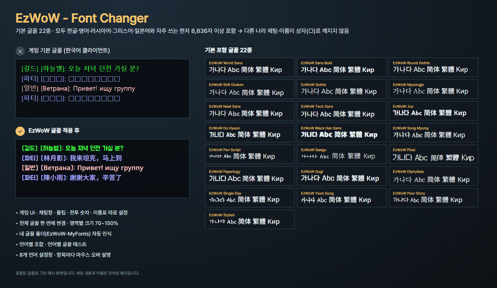
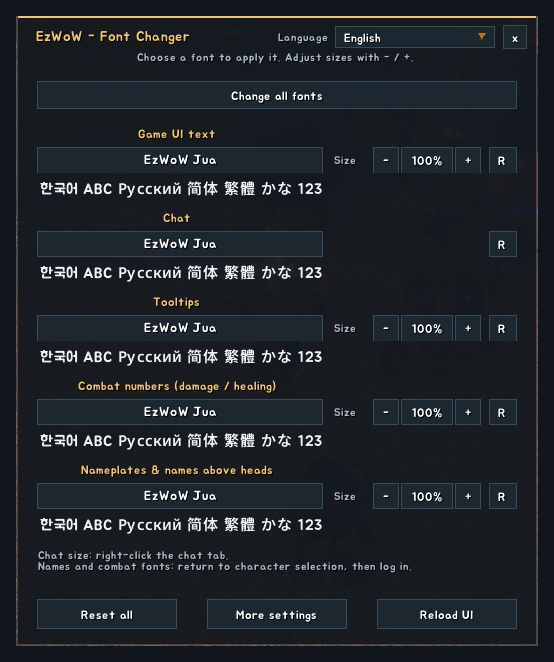

# EzWoW - Font Changer (`EzWoW-FontChanger`)

**[한국어](#한국어) · [English](#english)**

WoW Forever (`Interface: 16001`) · `v1.0.3` · `/ezfont`

---

## 한국어

게임 화면을 다섯 영역으로 나눠 각각 글꼴과 크기를 바꾸는 애드온입니다. 기본 글꼴 22종이 함께 들어 있고, 모두 한글·영어·러시아어·그리스어·일본어와 자주 쓰는 한자를 담고 있어서 **다른 나라 플레이어의 이름과 채팅이 상자(□)로 깨지지 않습니다.**

| 영역 | 바뀌는 곳 | 적용 시점 |
|---|---|---|
| 게임 전체 UI 글꼴 | 창·버튼·목록·퀘스트 글 등 | 바로 |
| 채팅창 | 채팅 글자, 입력창, 말풍선 | 바로 (크기는 채팅 탭 우클릭 → 글꼴 크기, 크기를 바꿔도 고른 글꼴은 유지) |
| 툴팁 | 마우스를 올리면 뜨는 이름·아이템·스킬 설명 | 바로 (처음에는 게임 UI 글꼴을 따름) |
| 전투 숫자 | 머리 위로 뜨는 피해·치유 숫자 | 재접속 후 |
| 이름표·머리 위 이름 | 이름표, 캐릭터·몬스터 머리 위 이름 | 이름표는 바로, 머리 위 이름은 재접속 후 |

### 화면 미리보기

> 실제 게임 화면입니다(WoW Forever, 한국어 클라이언트). 캐릭터 · 다른 플레이어 이름과 채팅 내용은 가렸습니다.

### 설정창 (`/ezfont`)

- **언어**: 오른쪽 위 상자를 누르고 목록에서 고르면 이 애드온 창의 글자가 바로 바뀝니다. 자동(게임 언어), 한국어, English, Deutsch, Français, Español, Русский, 简体中文, 繁體中文 중에서 고릅니다.
- **전체 글꼴 변경**: 다섯 영역의 글꼴을 한 번에 바꿉니다. 영역별 크기는 그대로 둡니다.
- **영역별 글꼴**: 글꼴 단추를 누르면 목록이 열리고(마우스 휠로 넘김), 글꼴 이름이 그 글꼴로 그려집니다. 고르면 바로 적용되고, 단추 아래에 `한국어 ABC Русский 简体 繁體 かな 123` 예문이 그 글꼴과 크기로 보입니다. 목록에서 글꼴에 마우스를 올리면 느낌과 들어 있는 글자를 알려 줍니다.
- **크기**: `-` / `+`로 70~150%(5% 단위). 가운데 숫자를 누르면 100%로, **R**은 그 영역만 기본값(툴팁은 '게임 UI 글꼴 따름')으로 되돌립니다. 채팅창은 게임의 채팅 탭 글꼴 크기를 그대로 씁니다.
- **툴팁**: 처음에는 '게임 UI 글꼴 따름'이라 UI 글꼴과 같이 바뀝니다. 다른 글꼴을 고르거나 크기만 따로 바꿀 수 있습니다.
- **재접속 후 적용**: 전투 숫자·머리 위 이름의 글꼴 파일은 게임이 접속할 때 한 번만 읽습니다. 바꾼 뒤에는 그 영역에 '재접속 후 적용'이 표시되니 캐릭터 선택 화면에 나갔다 들어오세요.
- 아래 단추: **모두 기본값**(모든 영역을 게임 글꼴·100%로, 내 글꼴과 언어별 조합은 그대로), **추가 설정**, **UI 다시 불러오기**.
- 모든 단추와 항목에 마우스를 올리면 설명이 나옵니다.
- 게임의 **설정 → 애드온 → EzWoW - Font Changer** 화면과 미니맵의 애드온 메뉴에서도 설정창을 열 수 있습니다.

### 포함된 글꼴

모든 글꼴은 예쁜 기본 글꼴의 글자를 그대로 쓰고, 그 글꼴에 없는 글자(악센트 문자, 그리스·키릴 문자, 일본어 가나, 기호)를 Noto 글꼴로 채워 넣었습니다. 한자는 중국·대만에서 일상적으로 쓰는 8,836자를 모든 글꼴에 넣어서, **어느 글꼴을 골라도 플레이어 이름과 채팅이 깨지지 않습니다.** EzWoW World Sans에는 드물게 쓰는 한자까지 2만 9천여 자가 모두 들어 있습니다.

| 글꼴 | 바탕 글꼴 | 느낌 |
|---|---|---|
| EzWoW World Sans | Pretendard | 깔끔한 기본 고딕, **모든 한자 포함** |
| EzWoW Sans Bold | Pretendard SemiBold | 굵은 고딕 |
| EzWoW Neat Sans | SUIT | 단정한 고딕 |
| EzWoW Tech Sans | IBM Plex Sans KR | 기계적인 고딕 |
| EzWoW Round Gothic | Gothic A1 | 둥글고 넓은 고딕 |
| EzWoW Gothic | 나눔고딕 | 익숙한 고딕 |
| EzWoW Soft Dodum | 고운돋움 | 부드러운 돋움 |
| EzWoW Myeongjo | 나눔명조 | 명조 |
| EzWoW Song Myung | 송명 | 붓 느낌 명조 |
| EzWoW Jua | 주아 | 동글동글 굵은 |
| EzWoW Do Hyeon | 도현 | 각진 제목용 |
| EzWoW Black Han Sans | 검은고딕 | 아주 굵은 제목용 |
| EzWoW Pen Script | 나눔손글씨 펜 | 손글씨 |
| EzWoW Gaegu | 개구 | 귀여운 손글씨 |
| EzWoW Pixel | 갈무리11 | 픽셀 (레트로 게임) |
| EzWoW Paperlogy | 페이퍼로지 | 반듯하고 세련된 고딕 |
| EzWoW Gugi | 구기 | 개성 있는 굵은 고딕 |
| EzWoW Diphylleia | 산골짜기 | 우아한 명조 |
| EzWoW Single Day | 싱글데이 | 동글동글 손글씨 |
| EzWoW Yeon Sung | 연성 | 굵은 붓 손글씨 |
| EzWoW Poor Story | 푸어스토리 | 편안한 손글씨 |
| EzWoW Stylish | 스타일리시 | 단정한 손글씨 |

모두 SIL Open Font License 1.1 글꼴을 고친 것이며, 출처와 라이선스는 `Fonts/LICENSE-EzWoWFonts.txt`, 만드는 방법은 `scripts/build_fonts.py`에 있습니다.

### 추가 설정

설정창 아래 **추가 설정**을 누르면 열립니다.

#### 언어별 글꼴 조합

**언어별 조합 설정**을 누르면 설정창 옆에 창이 열립니다. 문자 종류(영어·유럽 문자, 한글, 중국어 간체, 중국어 번체, 러시아어)마다 글꼴을 고른 다음, 영역 글꼴 목록에서 **언어별 조합**을 고르면 게임이 글자마다 그 언어의 글꼴로 그립니다 (`CreateFontFamily`). 예를 들어 영어는 판타지풍 명조, 한글은 동글동글한 글꼴로 꾸밀 수 있습니다. **모든 영역 글자 깨짐 방지 적용**을 누르면 채팅·UI는 언어별 조합, 머리 위 이름은 EzWoW World Sans로 한 번에 맞춥니다. 머리 위 이름과 전투 숫자는 글꼴 파일 하나만 쓸 수 있어서 조합 대신 EzWoW World Sans를 씁니다.

#### 글꼴 테스트

**글꼴 테스트**를 누르면 설정창 옆에 창이 열립니다. 한국어·영어(유럽)·러시아어·그리스어·중국어·일본어·기호 예문을 고른 영역의 글꼴로 그려 보고, 언어마다 "모두 표시 / 일부만 / 글자 없음"을 보여 줍니다. 영역 단추를 누를 때마다 테스트할 영역이 바뀌고, 입력칸에 깨져 보였던 플레이어 이름 등을 넣어 바로 확인할 수 있습니다.

#### 내 글꼴 추가

내 글꼴은 `Interface/AddOns/EzWoW-MyFonts/` 폴더에 넣습니다. 이 애드온 폴더 밖이라 업데이트해도 지워지지 않습니다. 와우 애드온은 폴더 안 파일 목록을 읽을 수 없어서, 아래 세 방법 중 하나로 인식시킵니다. 어느 방법이든 파일을 넣은 뒤 **게임을 다시 켜야** 합니다.

1. **이름 바꾸기 (가장 쉬움)**: 파일 이름을 `font1.ttf` ~ `font30.ttf`로 바꾸면 자동으로 인식됩니다.
2. **목록 만들기 (원래 이름 그대로)**: 저장소의 `tools/make_myfonts.ps1`을 그 폴더에 넣고 *PowerShell로 실행* 합니다. 파이썬이 있다면 `tools/make_myfonts.py <폴더>`도 됩니다. 폴더 안 모든 `.ttf`/`.otf`가 목록에 들어가고, 글꼴을 바꿀 때마다 다시 실행하면 됩니다.
3. **직접 입력**: 추가 설정의 **내 글꼴 추가** 칸에 파일 이름을 입력하고 **추가**를 누릅니다.

1·2번으로 찾은 글꼴은 목록에 `(자동)`이 붙고, 파일을 지우면 목록에서도 빠집니다. 직접 입력한 글꼴은 **삭제**로 뺄 수 있습니다. 다른 애드온이 공용 글꼴 목록에 등록한 글꼴도 글꼴 목록에 함께 나오고, 반대로 이 애드온의 기본 글꼴 22종도 그 목록에 등록됩니다.

### 나만의 글꼴 만들기 (PC 프로그램)

`tools/EzWoW-FontMaker.pyw`는 언어별로 고른 무료 글꼴을 하나의 `.ttf`로 합쳐 주는 PC 프로그램입니다 (Python 3 필요, 첫 실행 때 필요한 파이썬 패키지 설치를 안내합니다).

- 영어·유럽 문자 / 한글 / 러시아·그리스 문자 / 일본어 가나 / 한자 / 기호마다 글꼴·굵기·크기를 고릅니다. 한글 글꼴 16종, 영문 글꼴 5종, Noto 글꼴이 목록에 있고, 내 `.ttf` 파일도 쓸 수 있습니다.
- **저작권 안전장치**: OFL 라이선스가 확인된 글꼴만 받아들이고, 재료 글꼴의 예약 이름(Reserved Font Name)이 들어간 이름으로는 저장하지 않으며, 원본 저작권 표기를 글꼴 안과 `-LICENSE.txt` 파일에 자동으로 넣습니다.
- 고른 글꼴에 없는 글자는 같은 굵기의 Noto로 채워 네모(□)가 생기지 않습니다.
- **언어별 테스트**: 만들기 전에는 고른 글꼴로, 만든 뒤에는 결과 글꼴로 언어마다 그려 보고 "모두 표시 / 없음 N자"를 보여 줍니다. 직접 입력한 글자도 확인할 수 있습니다.
- 저장 폴더를 `Interface/AddOns/EzWoW-MyFonts`로 고르면 목록 파일까지 만들어 Font Changer가 게임 재시작 후 바로 인식합니다.

### 업데이트 후 꼭: 게임 완전 재시작

와우는 한 번 읽은 글꼴 파일을 게임을 끌 때까지 메모리에 들고 있습니다. 애드온을 업데이트하거나 글꼴 파일을 바꾼 뒤 `/reload`만 하면 예전 글꼴이 계속 쓰여 글자가 깨져 보일 수 있으니, **게임을 완전히 껐다 켜세요.**

### 명령어

- `/ezfont` (`/ezwowfontchanger`) : 설정창 열기/닫기
- `/ezfont reset` (`/ezfont 초기화`) : 모든 영역을 게임 기본 글꼴과 100% 크기로 되돌리기
- `/ezfont 진단` (`diag`) : 중국어가 어떻게 그려지는지 확인하는 창

<!-- ezwow-pad-share -->
### 게임패드
- 게임패드 UI를 켜면 EzWoW 창을 패드로 다룰 수 있습니다. 방향키로 이동, A(✕)로 누르기, X(□)로 오른쪽 클릭, LB/RB로 스크롤, B(○)로 닫기입니다. 창 아래에 연결된 패드 모양으로 키 안내가 나옵니다.
- 블리자드 창이 열려 있지 않을 때 **보기(Back) / Create 버튼**을 누르면 화면의 EzWoW 프레임(유틸리티 바, 퀘스트 목록 등)으로 이동합니다. 다시 누르거나 B를 누르면 돌아갑니다.
- 다른 버튼을 쓰려면 설정 > 단축키 > 애드온 > EzWoW > "게임패드: EzWoW 창으로 이동/돌아가기"에 지정합니다(EzWoW-MapFinder가 설치돼 있을 때).

### 기록 공유
- 모든 EzWoW 애드온이 함께 쓰는 기록 공유가 **기본으로 켜져 있습니다**. 직접 확인한 퀘스트 NPC, 희귀 몬스터 목격, 아이템 드롭, 채집 위치를 다른 EzWoW 사용자와 나눕니다.
- `/ezshare` 또는 `/공유`: `on` / `off` 켜기·끄기, `channel on` / `channel off` 서버 채널 사용, `status` 현재 상태와 기록 수.

---

## English

Changes the font and size of five parts of the game separately: the game UI, chat, tooltips, combat numbers, and nameplates / names above heads. The 22 bundled fonts each contain Hangul, Latin, Cyrillic, Greek, kana and the everyday Han characters, so **names and chat from other regions no longer show as boxes (□)**.

| Area | What changes | When |
|---|---|---|
| Game UI text | Windows, buttons, lists, quest text | At once |
| Chat | Chat text, input box, chat bubbles | At once (size: right-click a chat tab > Font Size; your font is kept when the size changes) |
| Tooltips | Names, items and spell descriptions on hover | At once (follows the game UI font at first) |
| Combat numbers | Damage and healing numbers above heads | After a relog |
| Nameplates & names above heads | Nameplates, names above characters and creatures | Nameplates at once, names above heads after a relog |

> In-game screenshots with the addon set to English. The game client is Korean, so game text such as zone, item and spell names stays Korean. Character and player names and chat text are blurred.

**Settings window** (`/ezfont`, also from the game's *Settings → AddOns → EzWoW - Font Changer* page and the minimap addon menu):

- **Language**: click the box at the top right and pick a language from the list; the addon's windows switch right away. *Automatic* follows the game language.
- **Change all fonts** sets one font for all five areas; each area keeps its size.
- **Font per area**: the picker draws every font name in its own face (mouse wheel for more), applies your choice at once and shows a sample (`한국어 ABC Русский 简体 繁體 かな 123`) below the button. Hover a font in the list for its style and letters.
- **Size**: `-` / `+` for 70–150% in 5% steps; click the number for 100%; **R** resets only that area. Chat uses the game's chat tab font size.
- **Tooltips** follow the game UI font at first, or get their own font and size.
- Combat numbers and names above heads read their font file once per login; after a change the area shows *Log in again to apply*.
- Bottom buttons: **Reset all** (game font at 100% everywhere; your fonts and the per-language mix stay), **More settings**, **Reload UI**. Every control has hover help.

Bundled fonts (modified SIL OFL 1.1 fonts, built by `scripts/build_fonts.py`; see the Korean table above for the base fonts): each keeps a pretty base font and fills every missing non-Han letter (accents, Greek, Cyrillic, kana, symbols) from Noto, plus the 8,836 everyday Han characters, so any of them works alone for every language; **EzWoW World Sans** has every Han character.

**More settings** (button at the bottom of the settings):

- **Per-language mix**: pick a font for each alphabet (Latin, Korean, Simplified / Traditional Chinese, Russian), then choose *Per-language mix* as an area's font. The game draws each character with the font for its language (`CreateFontFamily`). *Stop broken letters in every area* sets chat and UI to the mix and names above heads to EzWoW World Sans in one click. Names above heads and combat numbers can use only one font file, so they use EzWoW World Sans instead of the mix.
- **Font test**: draws Korean, Latin, Russian, Greek, Chinese, Japanese and symbol samples with the chosen area's font and reports *All shown / Partly / Missing* for each; click the area button to switch areas and type a name to check it.
- **Add my font**: put `.ttf` files in `Interface/AddOns/EzWoW-MyFonts/` (outside this addon, so updates never delete them) and restart the game. Files named `font1.ttf`–`font30.ttf` and files listed by `tools/make_myfonts.ps1` / `tools/make_myfonts.py` are found automatically (marked *auto*); other names can be typed in and removed again. Fonts that other addons register in the common font list are listed too, and the 22 bundled fonts are registered there as well.

**Make your own font**: `tools/EzWoW-FontMaker.pyw` (Python 3) merges free fonts picked per alphabet into one `.ttf`, accepts only OFL-licensed fonts, keeps the original copyright notices, fills missing letters from Noto and can save straight into `EzWoW-MyFonts`.

**After an update, restart the game completely.** WoW keeps font files in memory until it closes, so `/reload` alone may keep the old font and show broken letters.

Commands: `/ezfont` or `/ezwowfontchanger` (settings), `/ezfont reset` (back to game fonts at 100%), `/ezfont diag` (a window that shows how Chinese text is drawn).

### Gamepad
- With the gamepad UI on, EzWoW windows work with a gamepad: D-pad to move, A (✕) to press, X (□) for right-click, LB/RB to scroll, B (○) to close. A key guide in your pad's button style shows under the window.
- With no game window open, press **View (Back) / Create** to move to the EzWoW frames on screen (Utility Bar, quest list and more). Press it again or B to go back.
- To use another button, set Key Bindings > AddOns > EzWoW > "Gamepad: move to / leave the EzWoW frames" (with EzWoW-MapFinder installed).

### Record sharing
- Record sharing, used by all EzWoW addons, is **on by default**. Quest NPCs, rare monster sightings, item drops and gathering spots you have seen yourself are shared with other EzWoW users.
- `/ezshare`: `on` / `off` to turn it on or off, `channel on` / `channel off` for the server channel, `status` for the current state and record counts.

---

## Support / 후원

If you find this addon useful, you can support its development.

애드온이 도움이 되셨다면 개발 후원으로 응원해 주세요.

[Buy Me a Coffee ☕](https://buymeacoffee.com/qqhrqqhr2)

