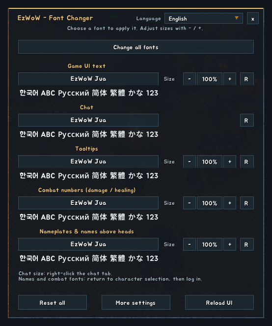
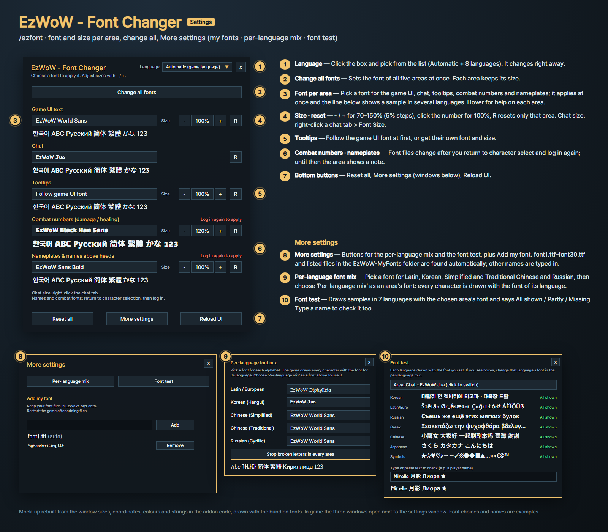
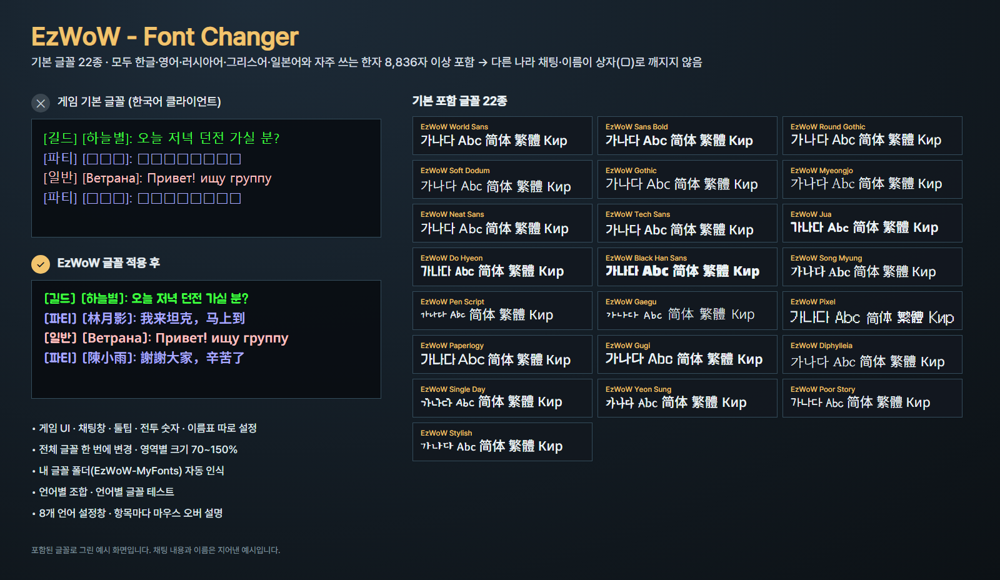
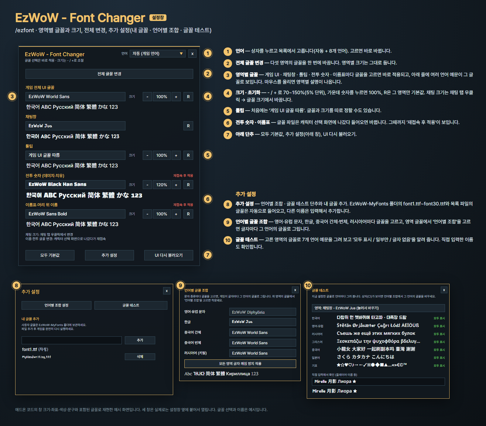

<!--
CurseForge summary (EN): Change the font and size of the game UI, chat, tooltips, combat numbers and nameplates, with 22 bundled fonts that never show other languages as boxes.
CurseForge summary (KO): 게임 UI·채팅·툴팁·전투 숫자·이름표의 글꼴과 크기를 따로 바꾸고, 다른 나라 글자도 깨지지 않는 기본 글꼴 22종을 제공합니다.
-->

# EzWoW - Font Changer

**English** · [한국어](#한국어)

Change the font and size of five parts of WoW Forever separately: the game UI, chat, tooltips, combat numbers, and nameplates / names above heads. The 22 bundled fonts each contain Hangul, Latin, Cyrillic, Greek, kana and the everyday Han characters, so **names and chat from other regions no longer show as boxes (□)**.

*Mock-ups rebuilt from the window sizes, coordinates, colours and strings in the addon code, drawn with the bundled fonts. Chat lines and names are made up.*

## Features

### Fonts per area
- Game UI text, chat, tooltips, combat numbers, and nameplates / names above heads each get their own font.
- **Change all fonts** sets one font for every area at once; each area keeps its size.
- The font list draws every name in its own face, applies your pick at once and shows a sample in several languages under the button. Hover a font for its style and letters.
- Size 70–150% per area in 5% steps; click the number for 100%, **R** resets only that area. Chat follows the game's chat tab font size, and your font stays when that size changes.
- Tooltips follow the game UI font at first, or get their own font and size.
- Combat numbers and names above heads change after a relog; the window tells you when one is waiting.

### 22 bundled fonts
- Clean sans, bold, round, serif, brush, handwriting and pixel styles, all free fonts under the SIL Open Font License.
- Every font has Hangul, Latin with accents, Cyrillic, Greek, kana, symbols and 8,836 everyday Han characters; **EzWoW World Sans** has every Han character.

### More settings
- **Per-language mix**: pick a font for Latin, Korean, Simplified Chinese, Traditional Chinese and Russian letters; every character is drawn with the font of its language. One button sets chat and UI to the mix and names above heads to EzWoW World Sans.
- **Font test**: samples in 7 languages drawn with an area's font, with *All shown / Partly / Missing* for each, plus a box to type a name and check it.
- **Your own fonts**: put them in `Interface/AddOns/EzWoW-MyFonts/` (kept through updates). `font1.ttf`–`font30.ttf` are found automatically, other names can be typed in. Fonts other addons register in the common font list show up too.

### Easy to use
- Settings window languages: Automatic, English, 한국어, Deutsch, Français, Español, Русский, 简体中文, 繁體中文.
- Hover help on every control.
- Also opens from the game's Settings → AddOns page and the minimap addon menu.

## Gamepad
- With the gamepad UI on, EzWoW windows work with a gamepad: D-pad to move, A (✕) to press, X (□) for right-click, LB/RB to scroll, B (○) to close. A key guide in your pad's button style shows under the window.
- With no game window open, press **View (Back) / Create** to move to the EzWoW frames on screen. Press it again or B to go back.
- To use another button: Key Bindings > AddOns > EzWoW > "Gamepad: move to / leave the EzWoW frames" (with EzWoW-MapFinder installed).

## Record sharing
- Shared by all EzWoW addons and **on by default**: quest NPCs, rare monster sightings, item drops and gathering spots you have seen yourself are shared with other EzWoW users.
- `/ezshare on` / `off`, `/ezshare channel on` / `off`, `/ezshare status`

## Commands
- `/ezfont` (`/ezwowfontchanger`) — open the settings
- `/ezfont reset` — every area back to the game font at 100%
- `/ezfont diag` — a window that shows how Chinese text is drawn

After updating the addon or adding font files, **restart the game completely**; `/reload` alone keeps the old font files in memory.

---

## 한국어

WoW Forever의 게임 화면을 다섯 영역(게임 UI, 채팅창, 툴팁, 전투 숫자, 이름표·머리 위 이름)으로 나눠 각각 글꼴과 크기를 바꾸는 애드온입니다. 기본 글꼴 22종은 모두 한글·영어·러시아어·그리스어·일본어와 자주 쓰는 한자를 담고 있어서 **다른 나라 플레이어의 이름과 채팅이 상자(□)로 깨지지 않습니다.**

*애드온 코드의 창 크기·좌표·색상·문구와 포함된 글꼴로 재현한 예시 화면입니다. 채팅 내용과 이름은 지어낸 예시입니다.*

## 기능

### 영역별 글꼴
- 게임 UI, 채팅창, 툴팁, 전투 숫자, 이름표·머리 위 이름마다 글꼴을 따로 고릅니다.
- **전체 글꼴 변경**으로 모든 영역의 글꼴을 한 번에 바꿉니다. 영역별 크기는 그대로입니다.
- 글꼴 목록은 이름을 그 글꼴로 보여 주고, 고르면 바로 적용되며 단추 아래에 여러 언어 예문이 보입니다. 글꼴에 마우스를 올리면 느낌과 들어 있는 글자를 알려 줍니다.
- 영역마다 70~150%(5% 단위) 크기 조절. 가운데 숫자를 누르면 100%, **R**은 그 영역만 기본값. 채팅은 게임의 채팅 탭 글꼴 크기를 따르고, 크기를 바꿔도 고른 글꼴이 유지됩니다.
- 툴팁은 처음에 게임 UI 글꼴을 따르고, 글꼴과 크기를 따로 정할 수도 있습니다.
- 전투 숫자와 머리 위 이름은 재접속 후 바뀌며, 기다리는 중이면 설정창에 표시됩니다.

### 기본 글꼴 22종
- 깔끔한 고딕, 굵은 제목용, 둥근 글꼴, 명조, 붓글씨, 손글씨, 픽셀까지. 모두 SIL Open Font License 무료 글꼴입니다.
- 모든 글꼴에 한글, 악센트 문자, 키릴·그리스 문자, 일본어 가나, 기호, 자주 쓰는 한자 8,836자가 들어 있고, **EzWoW World Sans**에는 모든 한자가 들어 있습니다.

### 추가 설정
- **언어별 조합**: 영어·유럽 문자, 한글, 중국어 간체, 중국어 번체, 러시아어마다 글꼴을 고르면 글자마다 그 언어의 글꼴로 그립니다. 단추 하나로 채팅·UI는 언어별 조합, 머리 위 이름은 EzWoW World Sans로 맞출 수 있습니다.
- **글꼴 테스트**: 7개 언어 예문을 영역의 글꼴로 그려 보고 언어마다 "모두 표시 / 일부만 / 글자 없음"을 알려 줍니다. 깨져 보였던 이름을 직접 입력해 확인할 수도 있습니다.
- **내 글꼴**: `Interface/AddOns/EzWoW-MyFonts/` 폴더에 넣으면 업데이트해도 지워지지 않습니다. `font1.ttf`~`font30.ttf`는 자동으로 인식되고, 다른 이름은 입력해서 추가합니다. 다른 애드온이 공용 글꼴 목록에 등록한 글꼴도 함께 나옵니다.

### 편의 기능
- 설정창 언어: 자동, 한국어, English, Deutsch, Français, Español, Русский, 简体中文, 繁體中文.
- 모든 단추와 항목에 마우스 오버 설명.
- 게임의 설정 → 애드온 화면과 미니맵의 애드온 메뉴에서도 열 수 있습니다.

## 게임패드
- 게임패드 UI를 켜면 EzWoW 창을 패드로 다룰 수 있습니다. 방향키로 이동, A(✕)로 누르기, X(□)로 오른쪽 클릭, LB/RB로 스크롤, B(○)로 닫기입니다. 창 아래에 연결된 패드 모양으로 키 안내가 나옵니다.
- 블리자드 창이 열려 있지 않을 때 **보기(Back) / Create 버튼**을 누르면 화면의 EzWoW 프레임으로 이동합니다. 다시 누르거나 B를 누르면 돌아갑니다.
- 다른 버튼을 쓰려면: 설정 > 단축키 > 애드온 > EzWoW > "게임패드: EzWoW 창으로 이동/돌아가기" (EzWoW-MapFinder 설치 시)

## 기록 공유
- 모든 EzWoW 애드온이 함께 쓰며 **기본으로 켜져 있습니다**. 직접 확인한 퀘스트 NPC, 희귀 몬스터 목격, 아이템 드롭, 채집 위치를 다른 EzWoW 사용자와 나눕니다.
- `/ezshare on` / `off` (또는 `/공유`), `/ezshare channel on` / `off`, `/ezshare status`

## 명령어
- `/ezfont` (`/ezwowfontchanger`) — 설정창 열기
- `/ezfont reset` (`/ezfont 초기화`) — 모든 영역을 게임 기본 글꼴과 100% 크기로
- `/ezfont 진단` (`diag`) — 중국어가 어떻게 그려지는지 확인하는 창

애드온을 업데이트하거나 글꼴 파일을 넣은 뒤에는 **게임을 완전히 껐다 켜세요.** `/reload`만 하면 예전 글꼴 파일이 계속 쓰입니다.

---

**Support:** If you find this addon useful, you can support its development. [Buy Me a Coffee ☕](https://buymeacoffee.com/qqhrqqhr2)

**후원:** 애드온이 도움이 되셨다면 개발 후원으로 응원해 주세요. [Buy Me a Coffee ☕](https://buymeacoffee.com/qqhrqqhr2)
